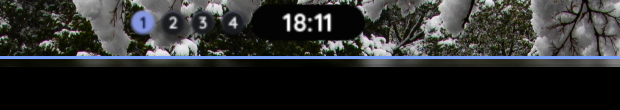
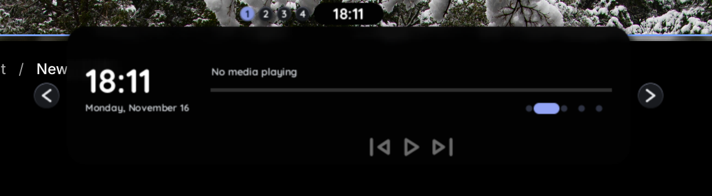
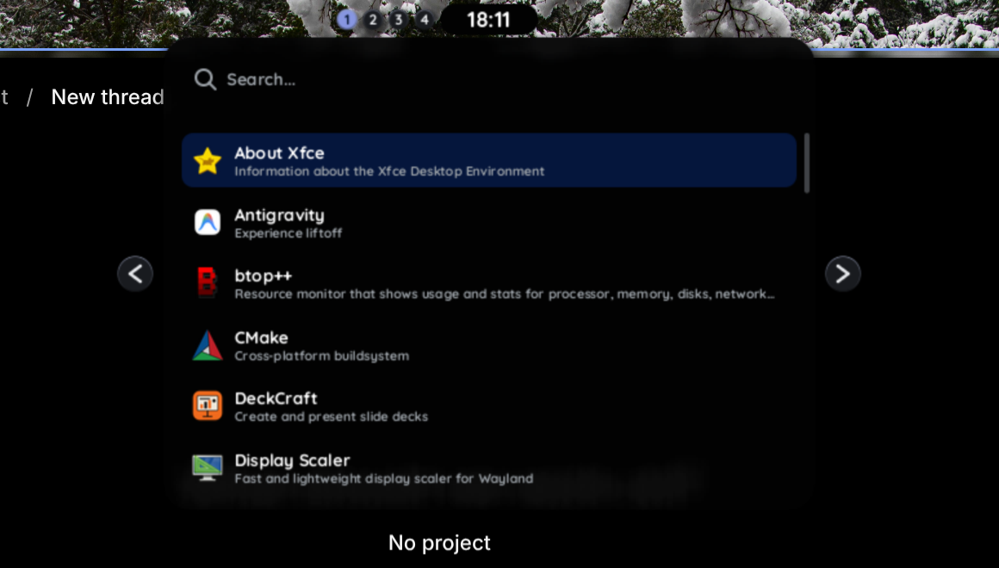
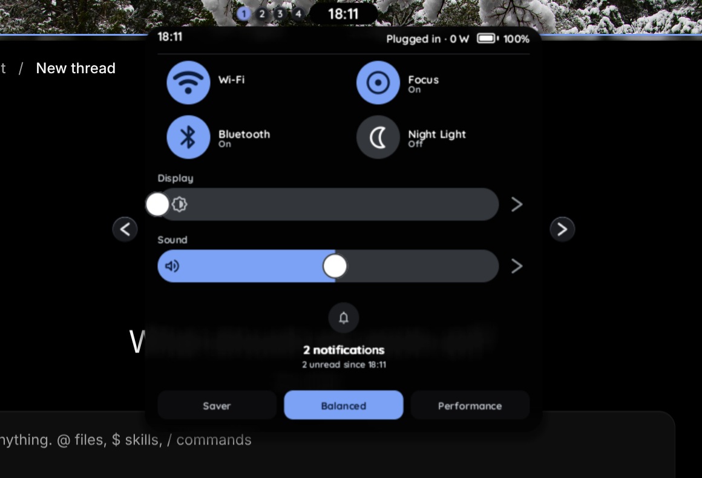
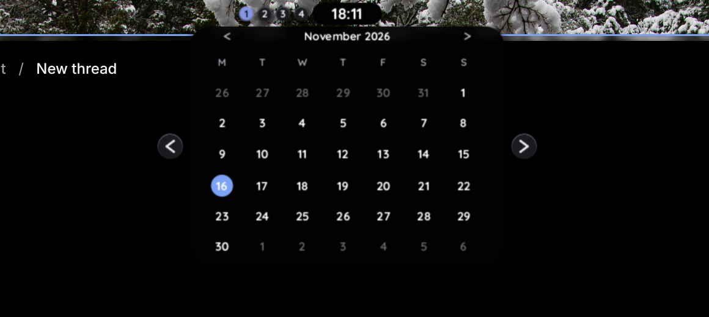
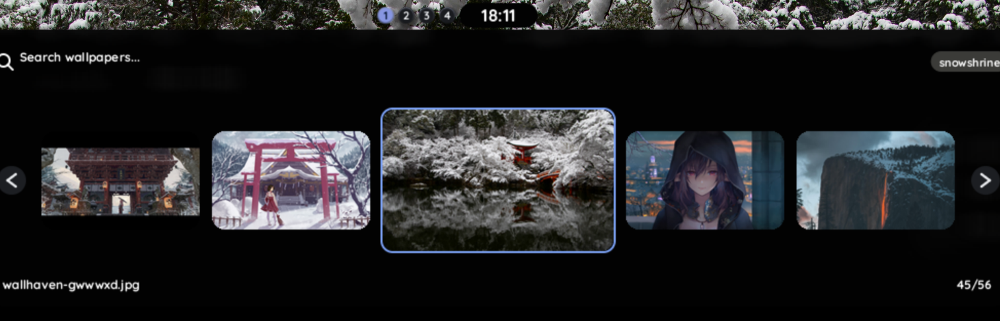
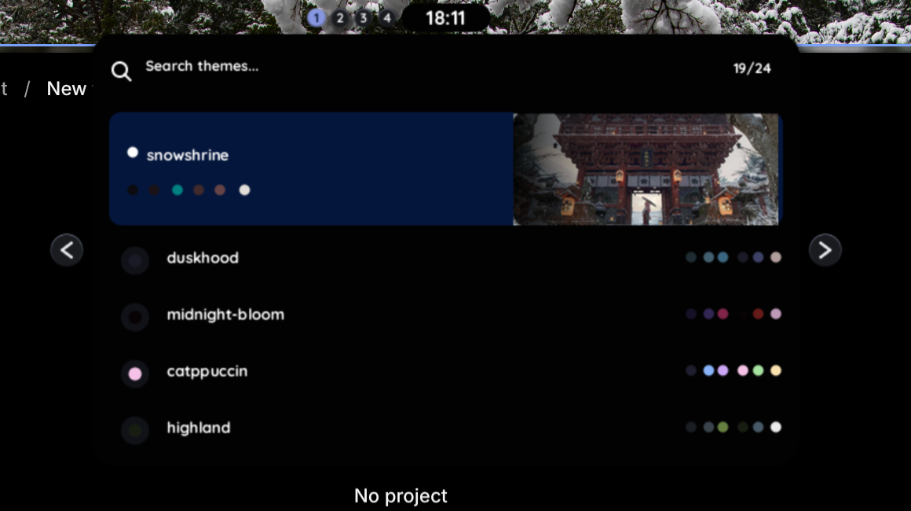
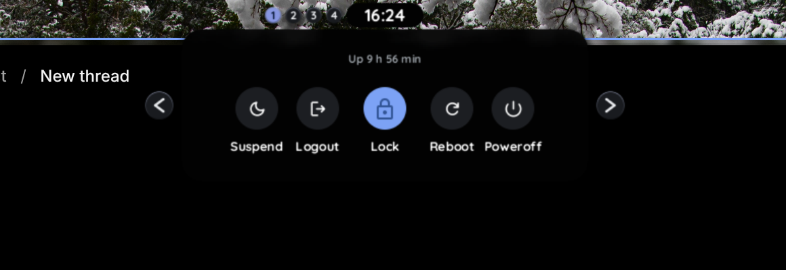

# Dynamite Island

**A Dynamic Island for [mangoWM](https://github.com/DreamMaoMao/mango) — written in Rust, rendered by hand, running in ~38 MB of RAM.**




A small black pill sits at the top of the screen: clock in the middle, workspace
circles on the left, tray icons on the right. Click it and it morphs — in about
200 ms — into one of eight fully working views. No placeholder UI anywhere:
every disc, slider and row is wired to the real system underneath.

## Views

| | | |
|---|---|---|
|  |  |  |
| **Music** — MPRIS controls, artwork, progress | **Launcher** — every installed app, live search | **Control Centre** — Wi-Fi, Bluetooth, sliders, battery |
|  |  |  |
| **Calendar** — month view, today highlighted | **Wallpapers** — browse and apply, 56 built in | **Themes** — 24 matched colour themes |
|  | | |
| **Power** — Suspend · Logout · Lock · Reboot · Poweroff | …plus a **Clipboard** view (history with image previews) on `Super+V` | |

## Features

- **Eight views, all real** — Music (MPRIS), Launcher (full `.desktop` scan,
  type-to-filter, real app icons), Control Centre (NetworkManager Wi-Fi,
  Bluetooth, Focus, Night Light, live brightness/volume sliders, battery with
  live charge watts), Calendar, Wallpapers, Themes, Power (`loginctl`), and
  Clipboard (`cliphist`).
- **Workspace circles** — four circles left of the pill, click to switch; the
  highlight follows switches made anywhere else in under half a second.
- **Built-in tray host** — a StatusNotifier host lives inside the island, so
  tray apps sit right of the pill with working menus.
- **Keyboard-first** — `Super+Space` opens the Launcher (it fully replaces
  rofi), `Super+V` the Clipboard, arrows cycle views, `↑`/`↓` + `Enter`
  navigate lists, and `Super+1..4` switches workspace even mid-menu.
- **Frosted panels** — the wallpaper is blurred in-buffer and laid under a
  neutral dark fill. Blur only, no glass tint.
- **Integrated lock screen** and a socket remote for keybinds and scripts.
- **One static Rust binary.** No Electron, no web view, no daemon zoo —
  ~38 MB PSS with every view exercised, against a hard budget of 100 MB.

## Controls

| Action | How |
|---|---|
| Open / close | Click the pill, `Esc` to close |
| Cycle views | Mouse wheel, the `‹` `›` discs, or `←` `→` |
| Launcher | `Super+Space` |
| Clipboard | `Super+V` |
| Navigate a list | `↑` `↓`, `Enter`, type to filter |
| Switch workspace | Click a circle, or `Super+1..4` |

## Build & run

You need a wlroots-based compositor with `wlr-layer-shell` (developed and
tested on mangoWM 0.18, Artix Linux) and a Rust toolchain. Features light up
with the usual tools installed: `nmcli`, `wpctl`, `brightnessctl`,
`playerctl`, `cliphist`.

```sh
cargo build --release
./target/release/dynamite-rust
```

Running the binary again with a command word — `dynamite-rust launcher`,
`dynamite-rust clipboard`, `dynamite-rust reload` — forwards it to the
running instance over `$XDG_RUNTIME_DIR/dynamite-rust.sock`. That is what the
compositor keybinds call.

## Configuration

`~/.config/dynamite-rust/config.conf`, plain `key=value` — see
[`config.example.conf`](config.example.conf) for every key. Changes apply
live via the `reload` remote or the settings app; no restart needed.

## Settings app

[`settings/dynamite_settings.py`](settings/dynamite_settings.py) is a small
GTK4 companion for the config file (geometry, behaviour, and a
lid/caffeinate toggle). It is the legacy Python UI — a native Rust port is
planned.

## Project layout

| File | What it is |
|---|---|
| `src/main.rs` | Island core: layer-shell surface, input, view state machine |
| `src/morph.rs` | The ~200 ms expand/collapse morph |
| `src/music_panel.rs` | Music view (MPRIS) |
| `src/launcher_panel.rs`, `src/launcher_icons.rs` | Launcher + embedded icon set |
| `src/controlcenter_panel.rs` | Control Centre |
| `src/calendar_panel.rs` | Calendar |
| `src/wallpaper_panel.rs`, `src/wallpaper_blur.rs` | Wallpaper picker + in-buffer frost blur |
| `src/themes_panel.rs` | Theme picker |
| `src/power_panel.rs` | Power menu |
| `src/clipboard_panel.rs` | Clipboard history |
| `src/tray.rs` | StatusNotifier tray host |
| `src/lockscreen.rs` | Lock screen |
| `src/library.rs` | Wallpaper/theme library + config persistence |

## Status

v0.62, under active development — built and screenshot-tested on a real
machine every step of the way.

## License

GPL-3.0-or-later — see [`LICENSE`](LICENSE).
